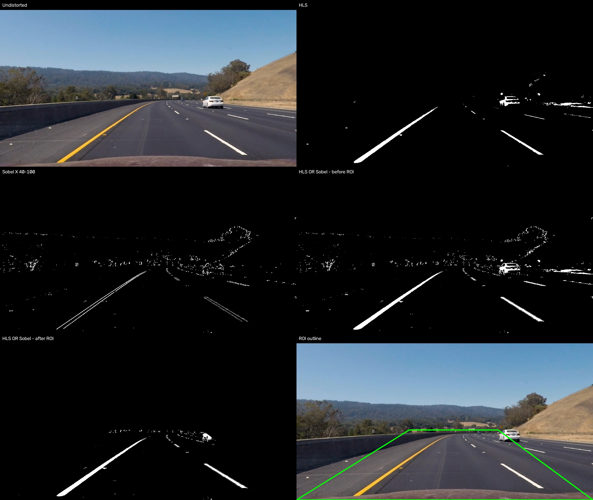
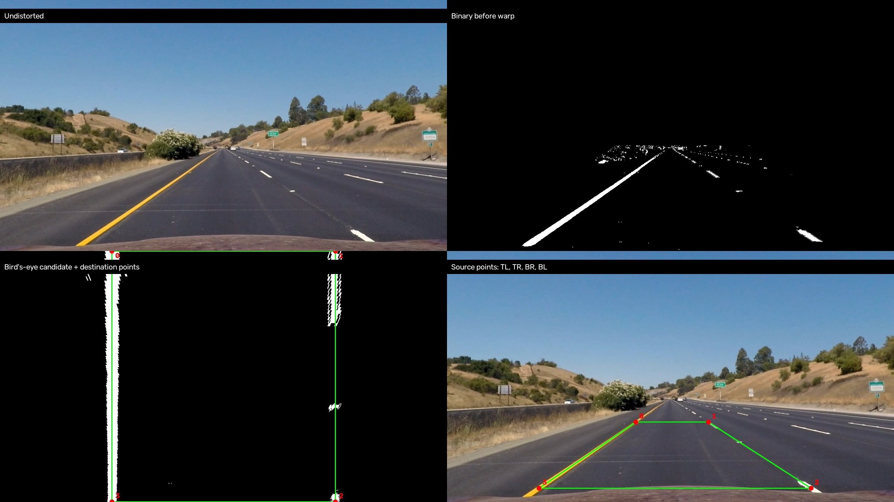
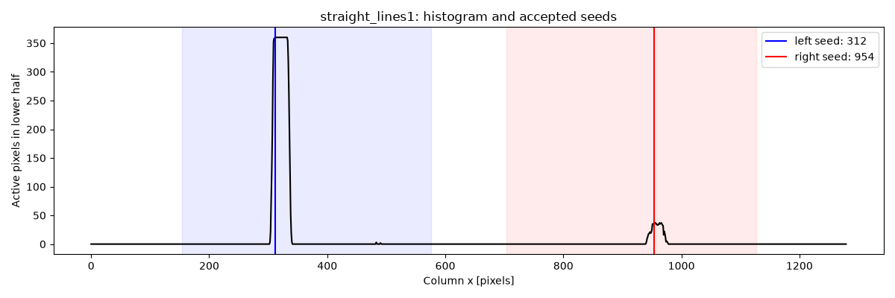
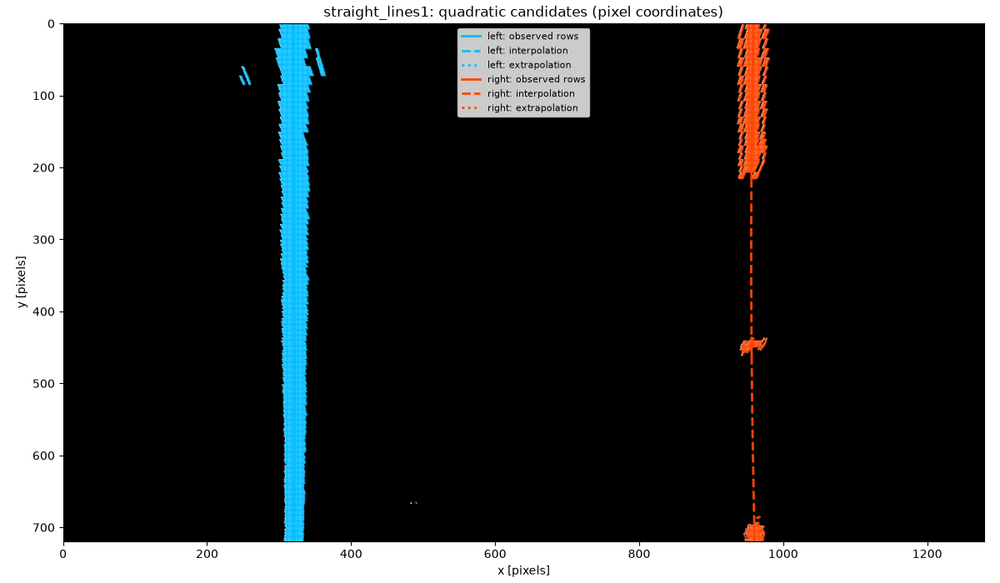
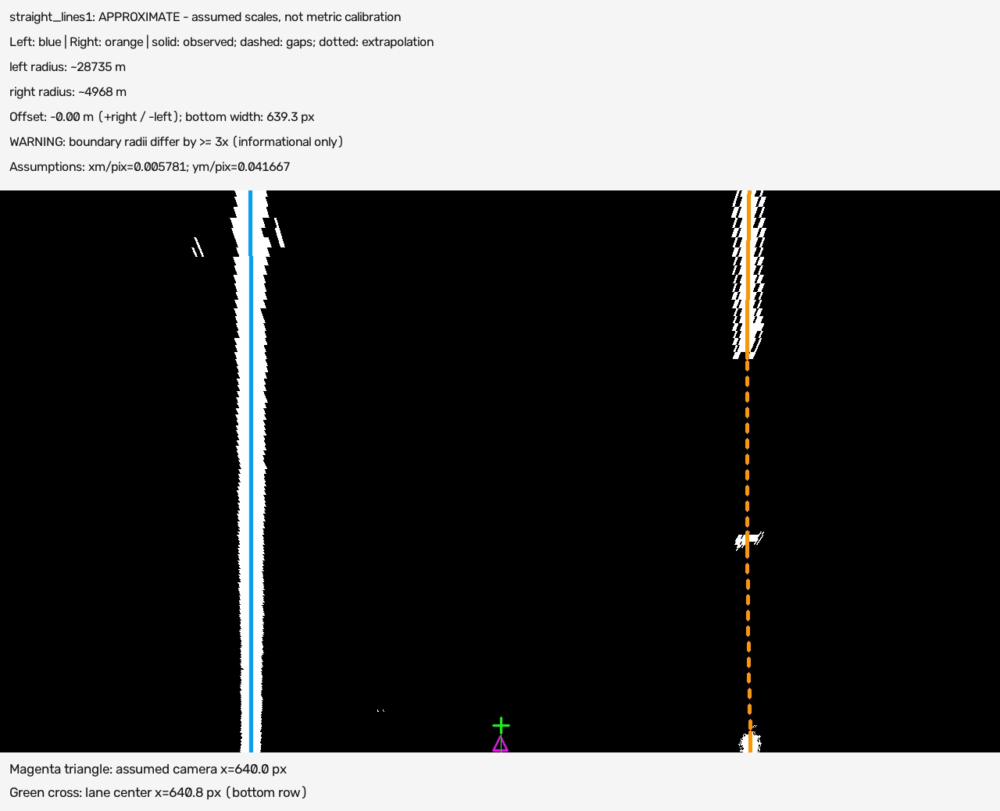
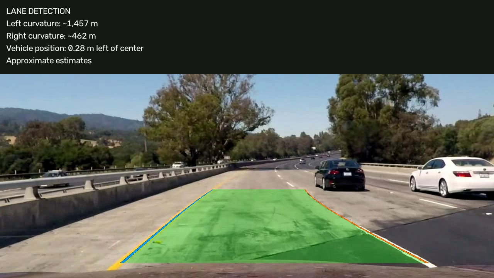
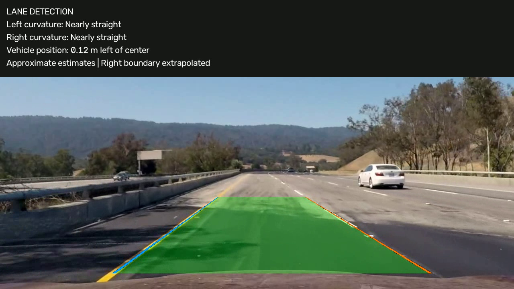
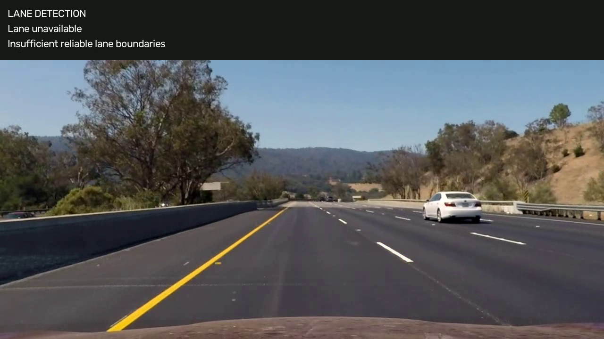
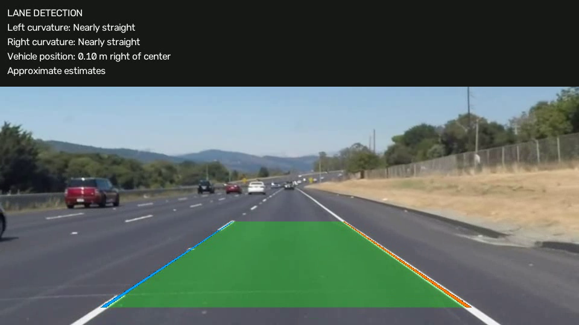
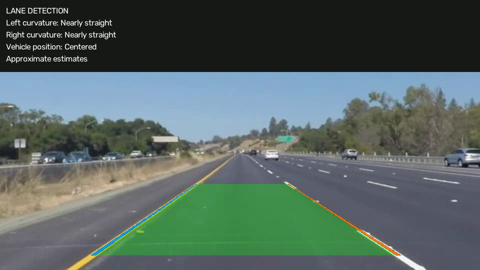

# Advanced Lane Finding

This project uses the questions and main structure of `writeup_template.md`, retained unchanged for reference. The implementation uses Python, NumPy and OpenCV to detect a lane and display approximate geometry. It is an educational computer-vision pipeline, not a validated vehicle-control system.

The project steps are:

1. Calibrate the camera from chessboards and correct lens distortion.
2. Extract candidate pixels using HLS color thresholds, Sobel X and a region of interest (ROI).
3. Transform the mask into a bird's-eye view.
4. Find boundary pixels using histogram initialization, Sliding Windows and controlled fallback.
5. Fit reliable quadratic polynomials and check their joint geometry.
6. Estimate curvature and vehicle position using assumed pixel-to-meter scales.
7. Map the accepted area back to the undistorted camera view.
8. Process video frames independently and retain diagnostic results.

## Writeup / README

### 1. Provide a Writeup that includes all the rubric points and how you addressed each one.

The following sections explain the actual implementation, choices, measured results and limitations. All displayed images are copies of project outputs in [`docs/`](./docs/), with provenance in [asset_manifest.json](./docs/asset_manifest.json). Final images are decoded frames from the final presentation videos, not illustrations of expected results.

| Stage | Source module | Relevant functions |
|---|---|---|
| Calibration | [camera_calibration.py](./src/camera_calibration.py) | `find_corners`, `detect_calibration_corners`, `calibrate_camera`, `save_undistortion_comparison` |
| Thresholding/ROI | [thresholding.py](./src/thresholding.py) | `load_calibration`, `undistort_image`, `color_mask`, `sobel_x_mask`, `threshold_image`, `create_roi_mask`, `binarize_image` |
| Perspective | [perspective_transform.py](./src/perspective_transform.py) | `validate_points`, `perspective_matrices`, `warp_binary` |
| Search/fitting | [lane_detection.py](./src/lane_detection.py) | `lower_half_histogram`, `find_start_positions`, `sliding_window_search`, `_initialize_fallback`, `fit_lane_polynomials` |
| Geometry | [lane_geometry.py](./src/lane_geometry.py) | `curvature_radius`, `compute_lane_geometry`, `uncertainty_labels`, `json_safe` |
| Overlay | [lane_overlay.py](./src/lane_overlay.py) | `lane_polygon`, `inverse_warp`, `render_overlay`, `format_overlay_text`, `draw_overlay_text` |
| Resolution | [video_config.py](./src/video_config.py) | `resolution_config`, `scale_calibration` |
| Video | [video_pipeline.py](./src/video_pipeline.py) | `make_context`, `process_frame`, `process_video`, `video_info`, `verify_video` |

## Camera Calibration

### 1. Briefly state how you computed the camera matrix and distortion coefficients. Provide an example of a distortion corrected calibration image.

Calibration estimates intrinsics and lens distortion before road features are measured. Without correction, lens curvature can be confused with road curvature. The supplied `camera_cal/` photographs contain a **9 by 6 inner-corner pattern**, corresponding to 10 by 7 squares. The initial 9 by 5 assumption was not retained.

`find_corners()` converts each image to grayscale and calls `cv2.findChessboardCorners()`. Successful detections are refined with `cv2.cornerSubPix()`: an 11 by 11 search window, no zero zone, and termination at 30 iterations or epsilon 0.001. This improves localization beyond the initial estimate. `cv2.drawChessboardCorners()` annotates copies for review.


For each view, `object_points` contains 54 planar points `(i, j, 0)`, using one board square as an arbitrary unit. `image_points` contains their matching refined 2D pixel coordinates. `cv2.calibrateCamera()` estimates intrinsics, five distortion coefficients and a separate board pose per image. The board unit does not establish road distances in meters.

Of 20 photographs, 17 produced complete detections. `calibration1.jpg`, `calibration4.jpg` and `calibration5.jpg` did not yield a complete pattern. The detection result alone cannot establish a unique reason: clipping, viewpoint, contrast and distortion are possible contributors, not verified diagnoses. Detected images `calibration7.jpg` and `calibration15.jpg` are 1281 by 721 rather than 1280 by 720. They were excluded rather than assuming an unverified resize/crop relationship. **15 views at 1280 by 720** were used.

The saved matrix and distortion coefficients in OpenCV order `(k1, k2, p1, p2, k3)` are:

```text
K = [[1158.77475394,    0.00000000, 669.64274130],
     [   0.00000000, 1154.07660739, 388.07945041],
     [   0.00000000,    0.00000000,   1.00000000]]

D = [-0.25677908, 0.04338452, -0.00068745, 0.00012577, -0.11502546]
```

The **mean reprojection error is 0.691184 pixels**, and the **RMS error is 0.852880 pixels**. `cv2.projectPoints()` projects each board model into its image; distances to the refined observations are residuals. Mean error averages their Euclidean distances; RMS weights larger errors more strongly. All views have 54 corners. Per-view means range from about 0.184 to 1.087 pixels; every per-view value is in [calibration_report.json](./results/calibration/calibration_report.json).

These are residuals on the calibration views, not independent validation on unseen scenes. Straight board edges provide a visual check, but neither successful execution nor a small residual proves perfect calibration.


Parameters are saved in `results/calibration/camera_parameters.npz`. Later stages load them and use `cv2.undistort()`, without repeating calibration per frame.

## Pipeline (single images)

### 1. Provide an example of a distortion-corrected image.

`thresholding.load_calibration()` reads the saved matrix, distortion and reference size. `undistort_image()` calls `cv2.undistort()` with the same matrix as the output matrix. Dimensions are retained, without introducing a new crop policy. By default it rejects mismatched resolutions unless a full-frame resize is explicitly authorized.


The final video configuration handles the adopted same-camera assumption for the three project videos explicitly, as described below. That assumption is not automatically extended to every 960 by 540 still photograph.

### 2. Describe how (and identify where in your code) you used color transforms, gradients or other methods to create a thresholded binary image. Provide an example of a binary image result.

HLS separates lightness from hue and saturation, making bright white and saturated yellow markings easy to describe. Sobel X detects changes across approximately vertical lane edges, including some paint missed by color thresholds. Neither cue identifies paint semantically: barriers, vehicles and pavement texture may also pass.

`threshold_image()` converts **BGR to HLS** using OpenCV channel conventions. Thresholds are inclusive:

| Cue | Channel | Accepted values |
|---|---|---|
| White | Lightness | 200–255 |
| Yellow | Hue | 15–40 |
| Yellow | Saturation | 100–255 |
| Yellow | Lightness | 40–255 |
| Sobel X | Absolute derivative of HLS lightness, normalized to 0–255 | 40–100 |

The Sobel kernel is 3. Its absolute derivative is normalized by the maximum in the current image. A zero maximum returns an all-zero mask, avoiding division by zero. This threshold therefore depends on image contrast rather than fixed physical edge strength.

`binarize_image()` combines color and gradient with logical OR and intersects with `create_roi_mask()`:

```text
binary = (white OR yellow OR Sobel_X) AND ROI
```

Normalized ROI vertices, in polygon order, are:

```text
(0.00, 1.00), (0.38, 0.58), (0.68, 0.58), (1.00, 1.00)
```

They are rasterized as `round(u*(width-1), v*(height-1))`. This retains the lower road while suppressing much of the sky, vegetation and roadside detail. It is a fixed geometric mask, not road-surface segmentation, and can remove paint in sharp bends.



The original Sobel 20–100 range added excessive background edges. Comparisons of 20–100, 40–100 and 60–150 on `straight_lines1`, `test1` and `test3` led to 40–100 as a compromise. It was not chosen simply to minimize white pixels.

The final thresholding report records 17/17 processed still images: eight at calibration resolution were corrected; nine smaller images were thresholded without asserting camera compatibility. In-memory masks are `uint8` 0/1; PNG previews use 0/255. A selected pixel remains a **candidate**, not a confirmed marking.

### 3. Describe how (and identify where in your code) you performed a perspective transform and provide an example of a transformed image.

A bird's-eye view reduces perspective convergence and makes column histograms and windows practical. `perspective_matrices()` uses `cv2.getPerspectiveTransform()` for forward `M` and reverse `Minv`. At 1280 by 720, points are ordered top-left, top-right, bottom-right, bottom-left:

| Corner | Source `(x, y)` | Destination `(x, y)` |
|---|---|---|
| Top-left | (540, 490) | (320, 0) |
| Top-right | (748, 490) | (960, 0) |
| Bottom-right | (1042, 680) | (960, 719) |
| Bottom-left | (263, 680) | (320, 719) |

These `paint_aligned` points came from actual markings on corrected `straight_lines1`, then were visually checked on `test1` and `test3`. They are not just ROI vertices. Boundaries appear approximately parallel on the straight-road example; this does not establish metric accuracy in every curve.

`validate_points()` checks distinct finite points, convexity and order. Matrix rank and source-to-destination mapping are checked too. `warp_binary()` applies `cv2.warpPerspective()` with **`INTER_NEAREST`**, zero border and original dimensions, preserving 0/1 values.



Matrices and points are saved in `results/perspective_transform/perspective_parameters.npz` and the [perspective report](./results/perspective_transform/perspective_report.json). The transform is fixed per resolution. Pixels outside the source trapezoid are not cut by an additional polygon: the homography applies to the entire ROI mask, with mapped coordinates outside the output clipped. This distinction matters when diagnosing lost paint.

### 4. Describe how (and identify where in your code) you identified lane-line pixels and fit their positions with a polynomial?

#### Histogram and primary Sliding Windows

`lower_half_histogram()` sums active pixels by column over the lower half of the warped mask, where evidence is often less compressed than near the horizon. `find_start_positions()` searches normalized x regions **0.12–0.45 of width for the left side** and **0.55–0.88 for the right side**.

At 1280 by 720, a peak needs 20 active pixels. A distant competing peak at least 85% as strong causes abstention; the exclusion distance around the selected maximum is 60 pixels. If both seeds exist, separation must be 0.30–0.70 of image width. This avoids blindly choosing the two largest maxima, but cannot prove lane identity.



`sliding_window_search()` divides the image into **9 horizontal levels**, searched bottom to top. A window extends **80 pixels to either side** of its center. At least **50 assigned pixels** support a level and recenter the next window at their mean x; otherwise, the old center remains. Actual active coordinates are collected separately for each side. Overlapping windows assign pixels to the nearer center, preventing duplicate ownership.


#### Controlled fallback initialization

A dashed marking may be visible higher up even when the lower histogram is weak. `_initialize_fallback()` runs only for a side without a reliable primary seed. It examines the same nine bands and same side regions, keeping minimum peak support, local pixel support and ambiguity checks. A candidate must have plausible separation from the other boundary at that height, using its assigned pixels when available. Without another usable boundary or seed as an anchor, fallback does not invent an unanchored pair.

The strongest eligible candidate is rejected if a distant candidate has comparable strength. Otherwise, search starts **in that candidate's own band** and follows in both vertical directions. An upper seed is not incorrectly reused as a bottom coordinate. Existing ownership by the other side is preserved. Each initialization records its method, x coordinate, band, start window and reason.

Fallback does not relax the four-supported-window minimum or polynomial checks. In the eight-image evaluation, it recovered the right boundaries of `test2` and `test6`, each reaching five supported windows, with the other six results unchanged. Their primary peak was only 14 pixels, below 20. With fallback, seven of eight compatible still images passed both-boundary and geometry checks. This acceptance count is not accuracy.

`test1` still has only three supported right windows and remains unreliable. An isolated left-guided experiment added 55 mainly pavement-texture pixels and reached four windows, but was rejected after visual review. It is not integrated.

#### Quadratic fitting and reliability

`fit_lane_polynomials()` independently calls `np.polyfit(y, x, 2)` for eligible boundaries:

$$
x(y)=Ay^2+By+C.
$$

Writing x as a function of y suits mostly vertical bird-view boundaries. A quadratic describes moderate curvature with few parameters; more polynomial degrees would not resolve incorrect pixel identity.

At 1280 by 720, a boundary needs a reliable seed, no applicable search failure, **300 assigned pixels**, **100 distinct rows** and **4 supported windows**. The resulting coefficients and curve must be finite. Over the whole image height, the curve must stay inside the image, have span at most 35% of width, maximum absolute slope at most 2, and horizontal RMSE at most 40 pixels:

$$
\operatorname{RMSE}_x=\sqrt{\frac{1}{N}\sum_{i=1}^{N}\left(Ay_i^2+By_i+C-x_i\right)^2}.
$$

Successful execution of `polyfit` is insufficient. Every row is evaluated, distinguishing rows containing assigned pixels, internal gaps (interpolation) and rows beyond the observed extent (extrapolation). Production support flags mean at least one assigned pixel on that row, not dense or semantically correct evidence.



Even a smooth, low-RMSE curve can follow a barrier. Challenge results show that residuals and pixel counts do not establish correct marking identity.

### 5. Describe how (and identify where in your code) you calculated the radius of curvature of the lane and the position of the vehicle with respect to center.

#### Pixel-to-meter assumptions

`lane_geometry.curvature_radius()` uses reliable polynomials only. At reference resolution, assumed factors are:

$$
s_x=\frac{3.7}{640}\ \text{m/pixel},\qquad s_y=\frac{30}{720}\ \text{m/pixel}.
$$

They encode approximately 3.7 m across 640 bird-view pixels and a nominal longitudinal scale. They are **not measured road calibration**. In particular, the fixed perspective transform does not independently establish that the output height represents 30 m.

With $x_m=s_x x$ and $y_m=s_y y$, substitution gives:

$$
x_m(y_m)=a_m y_m^2+b_m y_m+c_m,
$$

$$
a_m=\frac{s_x}{s_y^2}A,\qquad b_m=\frac{s_x}{s_y}B,\qquad c_m=s_x C.
$$

This matches the code's coefficient conversion and is equivalent to scaling coordinates and refitting the same polynomial. Pixel coefficients are not directly inserted into a purported metric formula.

#### Radius at the bottom row

Evaluate at $y_{m,b}=(h-1)s_y$. The derivative formula is:

$$
R(y_{m,b})=\frac{\left[1+\left(2a_m y_{m,b}+b_m\right)^2\right]^{3/2}}{|2a_m|}.
$$

The result is in meters under the assumed scales. A small radius means stronger curvature. A near-zero second derivative gives a very large radius: small changes in a tiny quadratic coefficient can change R substantially while paths look similar. Incomplete markings, independent fits and approximate perspective also explain differing boundary radii.

If $|2a_m|\leq10^{-9}$, the computational status is `practically_straight`, with infinite radius. `json_safe()` serializes nonfinite values as `null`, retaining the explicit status. Unreliable fits have no radius estimate.

**Display policy is separate.** `format_overlay_text()` shows radii at least **10,000 m**, or `practically_straight` status, as `Nearly straight`. This does not change stored radius or acceptance and does not assert exactly straight road geometry. Other radii are rounded to whole meters with thousands separators.

#### Lane center and signed vehicle offset

At $y_b=h-1$, evaluate both pixel polynomials:

$$
x_L=x_{\mathrm{left}}(y_b),\qquad x_R=x_{\mathrm{right}}(y_b),\qquad w_b=x_R-x_L.
$$

The camera is assumed to be horizontally centered on the vehicle, at $W/2$. After geometry acceptance:

$$
x_c=\frac{x_L+x_R}{2},\qquad d=(W/2-x_c)s_x.
$$

Positive d means the vehicle is **right** of lane center; negative means **left**. An unreliable boundary prevents center and offset estimation; no missing boundary is invented. The display says `Centered` when $|d|\leq0.05$ m. This is a display tolerance, not positioning accuracy. Other values use two decimal places and direction.

`compute_lane_geometry()` checks:

- no crossing or reversed order over the **entire image height**, including a quadratic width extremum;
- bottom width within **400–900 pixels** at reference resolution;
- width variation at most **0.25**, defined as `(maximum width - minimum width) / bottom width` over the supplied observed vertical interval.

The video pipeline supplies the overlap of raw assigned-pixel y extents. This is a bounding interval, not a guarantee of simultaneous dense support at every row. If no usable overlap is supplied, the full height is used. Width extrema include the difference polynomial's vertex when inside the interval. These are configurable heuristics, not proof of metric geometry.

An informational warning remains when finite radii differ by at least three times, or one is practically straight and the other is not. It does not automatically reject geometry. Bottom extrapolation is recorded separately, since radius or offset may use an unobserved continuation, especially for dashed paint.

#### Recorded example

The saved `straight_lines1` geometry contains:

| Quantity | Value |
|---|---:|
| Left radius | 28,735.10 m |
| Right radius | 4,967.97 m |
| Left bottom x | 321.17 px |
| Right bottom x | 960.43 px |
| Bottom width | 639.26 px |
| Lane center | 640.80 px |
| Assumed vehicle x | 640.00 px |
| Signed offset | -0.00464 m |
| Width variation fraction | 0.00778 |

For example, `(640 - 640.802156) * (3.7/640)` is approximately -0.00464 m. Final formatting would show `Left curvature: Nearly straight`, `Right curvature: ~4,968 m` and `Vehicle position: Centered`. These are approximate estimates, not centimeter-accurate measurements. `test1` has no accepted right boundary and therefore no lane center or offset.



This earlier diagnostic figure deliberately retains detailed uncertainty labels and values; final video text is compact. The figure uses the same formulas and saved geometry.

### 6. Provide an example image of your result plotted back down onto the road such that the lane area is identified clearly.

`lane_overlay.render_overlay()` draws only when both fits are reliable and `geometry_accepted` is true. `lane_polygon()` joins the left path top-to-bottom and the reversed right path, checking ordering and bounds. `inverse_warp()` maps the filled polygon with `Minv` and `cv2.warpPerspective()`, using linear interpolation. It maps to the **undistorted camera image**, not directly onto the uncorrected raw frame.

The interior is green with alpha 0.3. A warped coverage mask limits blending to the lane, avoiding whole-image darkening. Left/right boundary lines have distinct visible colors. The text panel is composited last, scales with resolution, and sits above the important road region.





When a boundary is unreliable **or geometry is rejected**, the panel shows `Lane unavailable` and `Insufficient reliable lane boundaries`. There is no lane surface, curve overlay or metric display. JSON retains detailed rejection reasons even though the compact panel does not distinguish each one.



## Pipeline (video)

### 1. Provide a link to your final video output. Your pipeline should perform reasonably well on the entire project video (wobbly lines are ok but no catastrophic failures that would cause the car to drive off the road!).

Final outputs are linked below. The template's driving-quality statement is a goal, not a safety claim: no ground-truth driving validation exists, and some frames are deliberately unavailable.

| Main video | Final output | Resolution | FPS | Lane rendered / total | Acceptance |
|---|---|---|---:|---:|---:|
| project_video01 | [MP4](./results/video/final_presentation/project_video01/project_video01_final.mp4) | 960×540 | 25 | 221 / 221 | 100.00% |
| project_video02 | [MP4](./results/video/final_presentation/project_video02/project_video02_final.mp4) | 960×540 | 25 | 681 / 681 | 100.00% |
| project_video03 | [MP4](./results/video/final_presentation/project_video03/project_video03_final.mp4) | 1280×720 | 25 | 1243 / 1260 | 98.65% |

**Acceptance is not accuracy.** A frame counts when fits and geometry permit rendering. There are no manually annotated reference trajectories or dense lane-pixel labels for an accuracy calculation. Visual review provides diagnostic evidence, not an accuracy percentage.

The final presentation preserves resolution, FPS and all **2,162 decoded frames**. Per-frame numeric diagnostics match the previous final version exactly, excluding processing time. All 17 unavailable project_video03 frames were checked for absent road overlay; its longest failure period is five frames, or 0.20 s. See [validation.md](./results/video/final_presentation/validation.md), [validation_report.json](./results/video/final_presentation/validation_report.json) and [summary.json](./results/video/final_presentation/summary.json). Outputs are silent: source audio is not copied.

### Independent-frame implementation

`video_pipeline.process_frame(frame, context)` accepts uint8 BGR input and returns the annotated image plus diagnostics, reusing correction, binarization, warp, fallback-enabled search, fitting, geometry and rendering. `make_context()` caches fixed calibration/homographies, not detections.

`process_video()` uses `cv2.VideoCapture` and `cv2.VideoWriter`. `verify_video()` fully decodes the result, checking frame count, dimensions and FPS metadata. Reports retain initialization methods, coefficients, RMSE, support counts, geometric failures, extrapolation, warnings and timing. They measure adjacent accepted-frame center changes without bridging gaps and lengths of consecutive detection failures.

The final version has **no previous polynomial, temporal smoothing, between-frame interpolation or retained old lane**. `src/lane_tracking.py` remains experimental and is not called here. Its source and test file are retained solely to keep the existing 53-test discovery suite reproducible; this does not enable tracking in the final pipeline.

### Shared camera and two resolutions

For the three project videos, the project adopts the assumption of the **same camera, lens and full field of view**, with only resolution differing. This is not independently verified provenance. Equal aspect ratio alone would not establish it; a crop, different lens or different viewpoint would invalidate this transfer.

`video_config.scale_calibration()` uses:

$$
K_{W,H}=\operatorname{diag}\left(\frac{W}{1280},\frac{H}{720},1\right)K_{1280,720}.
$$

At 960 by 540, both factors are 0.75. Focal lengths and principal-point coordinates scale, while dimensionless distortion coefficients stay unchanged:

```text
K_960 = [[869.08106545,   0.00000000, 502.23205597],
         [  0.00000000, 865.55745554, 291.05958781],
         [  0.00000000,   0.00000000,   1.00000000]]
```

The tested point/threshold configuration uses **endpoint-normalized pixel factors**, distinct from the dimension ratios for K:

$$
q_x=\frac{W-1}{1279},\qquad q_y=\frac{H-1}{719},\qquad q_a=q_xq_y.
$$

Source/destination points are multiplied by `(q_x, q_y)`, normalized ROI vertices stay unchanged, and the homography is recomputed. This reproduces the tested policy rather than claiming exact invariance under every image-resampling convention.

| Parameter | 1280×720 | 960×540 policy / value |
|---|---:|---|
| Windows / minimum supported windows | 9 / 4 | unchanged |
| Window margin | 80 px | `round(80*q_x)` = 60 px |
| Pixels supporting/recentering a window | 50 | `ceil(50*q_a)` = 29 |
| Minimum assigned/fit pixels | 300 | `ceil(300*q_a)` = 169 |
| Minimum distinct fit rows | 100 | `ceil(100*q_y)` = 75 |
| Minimum histogram peak | 20 | `ceil(20*q_y)` = 15 |
| Peak exclusion distance | 60 px | `round(60*q_x)` = 45 px |
| Maximum fit RMSE | 40 px | `40*q_x` ≈ 29.99 px |
| Maximum absolute slope | 2 | `2*q_x/q_y` ≈ 2.0004 |
| Maximum curve span / width variation | 0.35 of width / 0.25 | unchanged |
| Bottom width bounds | 400–900 px | bounds times `q_x`, approximately 299.92–674.82 px |
| Horizontal / vertical metric factor | `3.7/640`, `30/720` | divide reference factors by `q_x`, `q_y` |

Normalized seed regions, ambiguity ratio, separation and HLS/Sobel settings stay unchanged. Counts are scaled, not tuned per clip to raise acceptance. `resolution_config()` accepts only the two supported sizes; mismatched contexts raise an error.





### Challenge evaluation

Challenge clips use the unchanged independent 1280 by 720 baseline. Their camera identity was not independently established; they test difficult scenes under the existing configuration, not a universal camera model. These outputs retain earlier diagnostic text, whereas the main clips use the approved final presentation.

| Video | Baseline output | FPS | Two accepted fits | Lane rendered / total | Rejected | Longest unavailable period |
|---|---|---:|---:|---:|---:|---|
| challenge01 | [MP4](./results/video/baseline/challenge01_baseline.mp4) | 25 | 243 | 243 / 251 (96.81%) | 8 | 5 frames / 0.20 s |
| challenge02 | [MP4](./results/video/baseline/challenge02_baseline.mp4) | 29.97003 | 290 | 278 / 484 (57.44%) | 206 | 28 frames / 0.93 s |
| challenge03 | [MP4](./results/video/baseline/challenge03_baseline.mp4) | 25 | 293 | 268 / 1199 (22.35%) | 931 | 218 frames / 8.72 s |

The difference between accepted fits and rendered lanes is joint geometry rejection. See the [baseline comparison](./results/video/baseline/video_comparison.md) and per-video reports. Accepted fits may still identify the wrong objects.

Review found an incorrect left fence-side edge at `challenge02:399`, and incorrect right barrier/shoulder boundaries at `challenge03:121` and `449`. Neighboring frames were investigated too. Strong edges, many pixels and coherent geometry can all belong to something other than the ego-lane marking. Diagnostic frame indices are zero-based.

### Playback FPS versus processing speed

Output FPS controls playback timing, not achieved algorithm speed. The final presentation run measured approximately **6.84, 6.75 and 4.60 processing FPS** for project_video01/02/03, although all output files play at 25 FPS. These are machine/run-dependent measurements, not a real-time claim. End-to-end FPS includes additional I/O and is reported separately. No speed optimization was introduced.

## Discussion

### 1. Briefly discuss any problems / issues you faced in your implementation of this project. Where will your pipeline likely fail? What could you do to make it more robust?

### Experiments and decisions

The final algorithm follows visible white/yellow boundaries in the main clips while withholding a lane when support or geometry is insufficient. Fallback addresses missing lower histogram support; it does not solve all missing paint or semantic confusion. Eight compatible still images and six videos provide varied examples, but are too few and correlated to establish accuracy or safety.

| Investigation | Observed outcome | Final decision |
|---|---|---|
| Sobel ranges and ROI | 40–100 reduced distracting edges while preserving useful paint in reviewed examples | Keep selected threshold/ROI |
| Perspective coordinates | `paint_aligned` was visually preferable on reviewed images | Keep these fixed points |
| Fallback | Recovered right paint in test2/test6; other six stills unchanged | Integrated |
| Left-guided search on test1 | New pavement noise supplied the fourth window | Rejected; right side stays unreliable |
| Multi-candidate search | Real paint was sometimes available, but wrong barrier pairs still won; none of six accepted known-wrong frames was corrected | Not integrated |
| Support-aware width/span checks | Wrong barriers could also pass; extrapolation explained some but not all rejection | Do not loosen geometry globally or raise polynomial degree on this evidence |
| Wider ROI / alternative perspective | Some pixels recovered, but no dependable identity correction; alternate perspective added a wrong lane | Keep baseline ROI/perspective |
| Original-perspective identity signals | Color, bright-area width, contrast and alternative ridges overlapped between paint and other structures | Diagnostic only; no validated identity gate |
| Previous-polynomial search / tracking | Prolonged wrong concrete boundary at challenge03:126–147, adding 22 wrong accepted frames | Not integrated; independent frames remain final |
| Scaled calibration | Tested scaling under adopted same-camera/full-FOV assumption; final numeric results reproduced | Integrated for project videos |

Evidence remains in `results/evaluation/` and `results/video/` experiment folders: `quality_experiment`, `multi_candidate_experiment`, `geometry_assumptions_experiment`, `roi_perspective_experiment`, `marking_identity_experiment`, `tracking_experiment` and `scaled_calibration_experiment`. Their manual probes are sparse diagnostic judgments, not precise reference annotations. Merely removing more rendered lanes does not necessarily improve identification.

### Remaining limitations and next steps

- **Approximate metrics:** road scales and centered-camera position are assumed. Radius and offset are not precise physical measurements.
- **Dashed/occluded markings:** fitting interpolates gaps and may extrapolate the bottom used for geometry. The final panel marks bottom extrapolation, not every unsupported row.
- **Wrong-object identity:** concrete, shoulder, guardrail highlights and seams may pass HLS/Sobel. Geometry and small residuals are not semantic evidence.
- **Sharp curves:** paint can leave ROI, map outside the output or cross nominal side regions; valid visible paths can fail whole-height limits.
- **Shadows/visibility:** shadowed paint loses color support while strong non-paint edges survive Sobel. Reflective surfaces and vehicles add competition.
- **Frame independence:** curves can jitter or vanish. Tracking is excluded because it previously stabilized a wrong boundary.
- **No real-time demonstration:** source playback FPS is preserved but measured processing is slower.
- **Limited validation:** no dense reference annotations, independent metric measurements or independently confirmed camera identities. No precision/recall or metric estimation accuracy is claimed.

The highest-value next step is an independently annotated set of true paint and deceptive barriers/shoulders, followed by evaluation of identity and observable support. Only after that should tracking be reconsidered. More smoothing or relaxed gates could produce a steadier wrong lane. A more flexible curve alone does not fix pixel association.

### Conclusion

The delivered classical pipeline has explicit failure states, controlled fallback and a compact approximate-geometry display. Both project resolutions are supported under a stated camera assumption. Main-video results are useful, while difficult challenge failures remain documented rather than hidden by unvalidated temporal state or unsupported continuation.

## Installation and reproduction

Run commands **from `lane-finding/`**, containing this README, `src/`, `test_images/` and `test_videos/`. The recorded environment used Python 3.14.0. `requirements.txt` lists NumPy, OpenCV, Matplotlib and Pillow without version pins; compatibility with every other Python/package combination is not established.

### Environment and tests

Windows PowerShell:

```powershell
python -m venv .venv
.\.venv\Scripts\python.exe -m pip install -r requirements.txt
.\.venv\Scripts\python.exe -c "import cv2, numpy; print(cv2.__version__, numpy.__version__)"
.\.venv\Scripts\python.exe -m unittest discover -s tests
```

Reuse an existing `.venv` instead of recreating it. Explicit interpreter paths avoid needing activation. On POSIX, the corresponding path is `.venv/bin/python`; that platform was not independently validated in the recorded Windows run.

The main suite passed **53 tests**, including synthetic fitting, curvature, signed offsets, invalid geometry, fallback ambiguity, pixel ownership, overlays, display thresholds, both resolutions and video round trips. Synthetic success does not establish real-world marking identity. A further 36 isolated experiment tests passed during development. The following optional command requires the archived experiment folders; these folders are not needed to run the final pipeline or the main suite:

```powershell
.\.venv\Scripts\python.exe -m unittest results.video.resolution_960_experiment.test_resolution results.video.scaled_calibration_experiment.test_scaled_calibration results.video.marking_identity_experiment.test_diagnostics results.video.roi_perspective_experiment.test_experiment results.video.geometry_assumptions_experiment.test_experiment results.video.multi_candidate_experiment.test_experiment
```

Final presentation validation additionally compared every frame against previous final reports. Existing code, tests, results and the original template were preserved during this documentation task.

### Photographs and stage outputs

These are existing module entry points. They regenerate the corresponding `results/` outputs and can replace same-named derived files, but do not overwrite original photographs. Normal processing needs only saved calibration; recalibration is optional.

```powershell
# Optional: intentionally reproduce calibration.
.\.venv\Scripts\python.exe -m src.camera_calibration

# HLS/Sobel/ROI outputs for supplied stills.
.\.venv\Scripts\python.exe -m src.thresholding

# Perspective comparisons for straight_lines1, test1 and test3.
.\.venv\Scripts\python.exe -m src.perspective_transform

# Histogram, windows and polynomial outputs for those three images.
.\.venv\Scripts\python.exe -m src.lane_detection

# Geometry summaries from saved lane-detection files.
.\.venv\Scripts\python.exe -m src.lane_geometry

# Final overlay for the eight compatible 1280x720 stills.
.\.venv\Scripts\python.exe -m src.lane_overlay
```

For a single photograph using the exact resolution-aware video path:

```powershell
.\.venv\Scripts\python.exe -c "import cv2; from src.video_pipeline import process_frame; im=cv2.imread('test_images/straight_lines1.jpg'); out,diagnostics=process_frame(im); assert cv2.imwrite('results/still_overlay.jpg',out)"
```

The camera assumption must be justified before using this path for other 960 by 540 material; resolution alone is insufficient. Historical stage figures retain their explanatory captions and were not all regenerated during final video presentation.

### All three project videos

```powershell
.\.venv\Scripts\python.exe -m src.video_pipeline --all-project-videos --output-dir results/video/presentation_reproduction
```

For one video:

```powershell
.\.venv\Scripts\python.exe -m src.video_pipeline test_videos/project_video01.mp4 --output-dir results/video/single_reproduction
```

The CLI creates per-video subfolders containing `<video_name>_final.mp4`, `report.json` and representative frames, plus a root `summary.json`. Use a **new output root** per reproduction: nonempty destinations and existing summaries are refused. Approved outputs stay in `results/video/final_presentation/`. The CLI's default `results/video/final/` is already populated with the preceding final version.

### Required files and publication

Keep `src/`, `tests/`, `requirements.txt`, saved `results/calibration/camera_parameters.npz`, and access to input images/videos. `docs/` holds selected stills and audit metadata, not video copies. Relative MP4/report links target generated results. All six linked output videos and the linked reports must be explicitly included at their listed paths when publishing. Committing this README alone does not publish those outputs. The selected output videos are each below GitHub's 100 MiB regular-Git file limit; challenge03 exceeds the 50 MiB warning threshold. Browser uploads have a separate 25 MiB limit, so use Git for the selected submission files. See [GitHub file-size limits](https://docs.github.com/en/repositories/working-with-files/managing-large-files/about-large-files-on-github). If outputs are hosted elsewhere instead, update the links to their actual published locations.

## Validation and evidence limitations

All displayed images use `./docs/...`. Image files, local source/result links, table structure and math delimiters were checked locally. Equations use GitHub Markdown syntax and distinguish pixel/metric coefficients and camera/point scaling policies. [documentation_review.json](./docs/documentation_review.json) records the local checks and protected-file verification.

The following remain assumptions or manual checks: same camera/full-FOV equivalence, real metric road scale, correctness of every accepted boundary, generalization outside supplied inputs, and final math/video rendering on the publication host. GitHub supports the inline `$...$` and block `$$...$$` syntax used here through MathJax; see [GitHub mathematical expressions](https://docs.github.com/en/get-started/writing-on-github/working-with-advanced-formatting/writing-mathematical-expressions). No missing evidence is replaced with an accuracy claim. The original `writeup_template.md` is retained unchanged.
