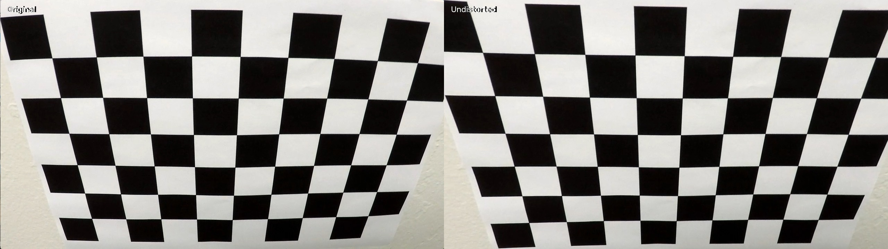
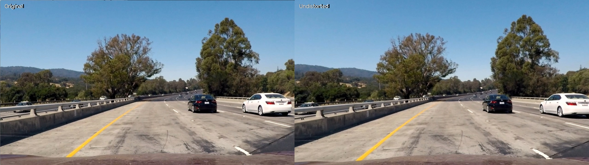
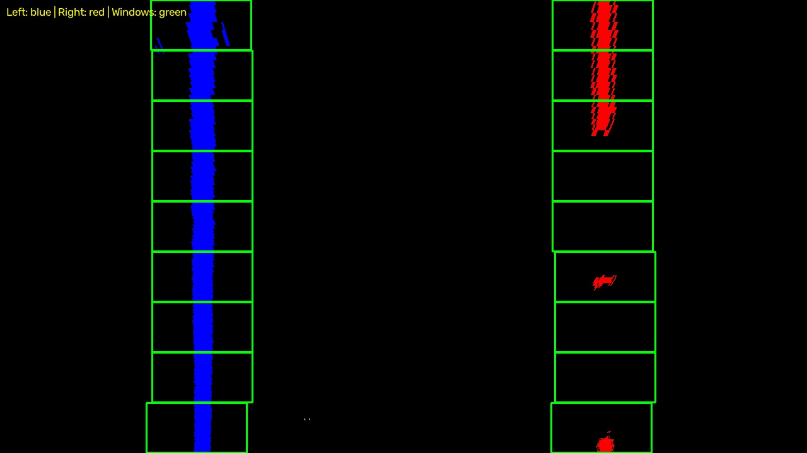
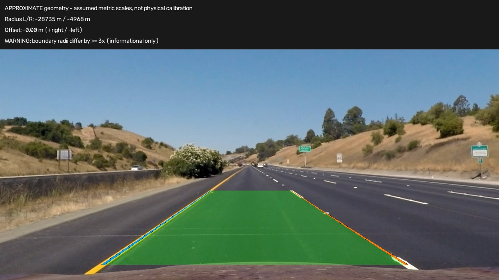

## Writeup Template

### You use this file as a template for your writeup.

---

**Lane Finding Project**

The goals / steps of this project are the following:

* Compute the camera calibration matrix and distortion coefficients given a set of chessboard images.
* Apply a distortion correction to raw images.
* Use color transforms, gradients, etc., to create a thresholded binary image.
* Apply a perspective transform to rectify binary image ("birds-eye view").
* Detect lane pixels and fit to find the lane boundary.
* Determine the curvature of the lane and vehicle position with respect to center.
* Warp the detected lane boundaries back onto the original image.
* Output visual display of the lane boundaries and numerical estimation of lane curvature and vehicle position.

[//]: # (Image References)

[image1]: ./examples/undistort_output.png "Undistorted"
[image2]: ./test_images/test1.jpg "Road Transformed"
[image3]: ./examples/binary_combo_example.jpg "Binary Example"
[image4]: ./examples/warped_straight_lines.jpg "Warp Example"
[image5]: ./examples/color_fit_lines.jpg "Fit Visual"
[image6]: ./examples/example_output.jpg "Output"
[video1]: ./project_video.mp4 "Video"

---

### Writeup / README

#### 1. Provide a Writeup that includes all the rubric points and how you addressed each one.

You're reading it!

### Camera Calibration

#### 1. Briefly state how you computed the camera matrix and distortion coefficients. Provide an example of a distortion corrected calibration image.

Camera calibration was performed using chessboard images from the `camera_cal/` directory. The implementation is available in [`src/camera_calibration.py`](./src/camera_calibration.py).

First, 20 calibration images were converted to grayscale, and the internal chessboard corners were detected using `cv2.findChessboardCorners()` with a pattern size of 9 × 6 corners. The detection was successful in 17 images. The detected corner positions were further refined using `cv2.cornerSubPix()`.

For calibration, corresponding 3D object points were generated assuming a flat chessboard (Z = 0), while the detected corner positions represented the 2D image points. Two images were excluded because their resolution differed from the others. Therefore, 15 images with a resolution of 1280 × 720 pixels were used with `cv2.calibrateCamera()` to estimate the camera matrix and distortion coefficients.

The resulting camera matrix was:

```text
[[1158.77475,    0.00000, 669.64274],
 [   0.00000, 1154.07661, 388.07945],
 [   0.00000,    0.00000,   1.00000]]
```

The distortion coefficients `(k1, k2, p1, p2, k3)` were:

```text
[-0.25677908, 0.04338452, -0.00068745,
  0.00012577, -0.11502546]
```

The calibration produced a mean reprojection error of 0.691 pixels and an RMS error of 0.853 pixels, indicating a reasonably good fit between the detected and projected chessboard corners.

The calculated parameters were saved in `results/calibration/camera_parameters.npz` for use in subsequent processing steps.

Finally, `cv2.undistort()` was applied to correct the lens distortion. The following comparison shows the original calibration image on the left and the distortion-corrected image on the right.



The correction visibly reduces the distortion of the chessboard lines, particularly near the edges of the image. The same parameters were also tested on a road image (`test1.jpg`) to confirm that distortion correction can be applied to the input images used in the lane detection pipeline.

Although the results are visually satisfactory, the reprojection errors were measured on the images used for calibration and do not independently validate the model on unseen images.

### Pipeline (single images)

#### 1. Provide an example of a distortion-corrected image.

The camera matrix and distortion coefficients calculated during the calibration stage were used to correct lens distortion in road images using `cv2.undistort()`.

The parameters were loaded from `results/calibration/camera_parameters.npz`, allowing distortion correction without repeating the calibration process. The implementation is provided in the `save_undistortion_comparison()` function in [`src/camera_calibration.py`](./src/camera_calibration.py).

The following figure shows the original `test1.jpg` image on the left and the distortion-corrected image on the right.



The correction introduces subtle geometric changes, particularly near the edges of the image, while preserving the natural shape of the road and lane markings. The corrected image can be used as input for the subsequent lane detection steps.

#### 2. Describe how (and identify where in your code) you used color transforms, gradients or other methods to create a thresholded binary image.  Provide an example of a binary image result.

To identify potential lane markings, a combination of color thresholding and gradient-based edge detection was implemented in [`src/thresholding.py`](./src/thresholding.py).

First, the input image was converted from BGR to the HLS color space. White lane markings were selected using a lightness threshold of 200–255, while yellow markings were detected using hue values of 15–40, saturation values of 100–255, and lightness values of 40–255.

Additionally, the Sobel operator was applied in the X direction to the HLS lightness channel. Several gradient thresholds were compared, and the range **40–100**, with a kernel size of 3, was selected as a suitable compromise between detecting lane edges and reducing noise.

The color and gradient masks were combined using a logical OR operation. A trapezoidal region of interest (ROI) was then applied to suppress irrelevant features outside the road area.

The resulting binary image contains values of 0 and 1, where 1 represents a potential lane-marking pixel.

The following figure presents the corrected input image, color mask, Sobel X mask, combined thresholding result, and ROI selection.


The method was tested on all 17 provided road images. Distortion correction was applied to eight images matching the calibration resolution, while the remaining nine images were processed without correction because their relationship to the calibration camera could not be confirmed.

The results show that the color thresholds successfully preserve prominent white and yellow lane markings, while the ROI substantially reduces unwanted detections from surrounding vegetation and other objects. Some noise remains within the road area, particularly around vehicles and road textures, and will need to be handled by subsequent lane detection stages.

#### 3. Describe how (and identify where in your code) you performed a perspective transform and provide an example of a transformed image.

The perspective transform is implemented in [`src/perspective_transform.py`](./src/perspective_transform.py). After distortion correction and binary thresholding, four source points are mapped to a rectangle to obtain a bird's-eye view. The selected `paint_aligned` points were based on visible lane markings in the corrected `straight_lines1.jpg` and visually checked on `test1.jpg` and `test3.jpg`.

For images of 1280 by 720 pixels, the coordinates are listed in top-left, top-right, bottom-right, bottom-left order:

```text
Source:      (540, 490), (748, 490), (1042, 680), (263, 680)
Destination: (320,   0), (960,   0), ( 960, 719), (320, 719)
```

`cv2.getPerspectiveTransform()` computes the forward matrix `M` and reverse matrix `Minv`. The binary image is transformed using `cv2.warpPerspective()` with `cv2.INTER_NEAREST`, preserving its 0/1 values and 1280 by 720 dimensions. The matrices and coordinates are saved in `results/perspective_transform/perspective_parameters.npz`, with a readable report in `perspective_report.json`.

The comparison below shows the corrected road image, the binary mask before transformation, the transformed mask with destination points, and the source-point selection. The lane boundaries appear approximately parallel in the bird's-eye view on the straight road section. This transformed binary mask will serve as input to the subsequent lane detection stage; the transform does not establish a physical distance scale.


#### 4. Describe how (and identify where in your code) you identified lane-line pixels and fit their positions with a polynomial?

Lane-line pixels were identified using a histogram-based sliding window search, implemented in [`src/lane_detection.py`](./src/lane_detection.py).

First, a histogram was calculated by summing the active pixels in each column of the lower half of the perspective-transformed binary image. The histogram peaks were used to estimate the initial positions of the left and right lane boundaries. Separate horizontal search regions and minimum peak requirements were applied to reduce incorrect detections.

Starting from these positions, the **Sliding Windows** algorithm searched for lane pixels from the bottom of the image upwards. The image was divided into **9 horizontal windows**, each with a horizontal margin of **80 pixels** around its center. When at least **50 pixels** were detected inside a window, its horizontal center was updated using the mean position of those pixels. The coordinates belonging to the left and right lane boundaries were collected separately.

The following figures show the histogram with the detected starting positions and the sliding window search results:




After collecting the lane pixels, a **second-degree polynomial** was fitted independently to each boundary using `np.polyfit()`:

\[
x(y) = ay^2 + by + c
\]

Before fitting, each boundary was checked for sufficient data, requiring at least **300 detected pixels**, **100 distinct image rows**, and **4 supported windows**. Additional checks were applied to the resulting polynomial, including residual error and geometric constraints.

The fitted curves were evaluated across the image height. This allowed the algorithm to represent continuous lane boundaries as well as estimate their positions across gaps between detected lane markings.


The method was tested on `straight_lines1.jpg`, `test1.jpg`, and `test3.jpg`. Both lane boundaries were accepted for `straight_lines1` and `test3`. However, the right boundary in `test1` was rejected because only three windows contained sufficient supporting pixels. In this case, the algorithm retained the reliable left boundary without generating an unsupported polynomial for the right boundary.

These results demonstrate that the method can identify lane-line pixels and approximate their positions using quadratic polynomials, while detecting cases where the available information is insufficient for reliable fitting.

#### 5. Describe how (and identify where in your code) you calculated the radius of curvature of the lane and the position of the vehicle with respect to center.

The radius of curvature and the vehicle's position relative to the lane center are calculated in [`src/lane_geometry.py`](./src/lane_geometry.py), using the `curvature_radius()` and `compute_lane_geometry()` functions.

After identifying lane-line pixels and fitting a second-degree polynomial to each lane boundary, the polynomial coefficients are used to estimate the road curvature and the vehicle's lateral offset. Each lane boundary is represented by:

$$
x(y) = Ay^2 + By + C
$$

**Radius of Curvature**

Since the lane coordinates are initially expressed in pixels, they are converted into meters using the following approximate scaling factors:

- `ym_per_pix = 30 / 720` meters per pixel in the vertical direction.
- `xm_per_pix = 3.7 / 640` meters per pixel in the horizontal direction.

The polynomial coefficients are converted into metric coordinates before calculating the radius of curvature. The radius is calculated using:

$$
R(y) = \frac{\left(1 + (2Ay + B)^2\right)^{3/2}}{|2A|}
$$

Here, `A` and `B` represent the polynomial coefficients expressed in metric coordinates. The radius is evaluated at the bottom of the image (`y = height - 1`), corresponding to the road closest to the vehicle.

A larger radius indicates a straighter road, while a smaller radius indicates a sharper curve. The radius is calculated independently for the left and right lane boundaries, provided that their polynomial fits are reliable.

**Vehicle Position Relative to Lane Center**

To estimate the vehicle's lateral position, the left and right polynomials are evaluated at the bottom of the image. The lane center is calculated as the midpoint between the two detected boundaries:

$$
x_{\text{lane center}} = \frac{x_{\text{left}} + x_{\text{right}}}{2}
$$

The camera is assumed to be mounted at the horizontal center of the vehicle, so its position is approximated by:

$$
x_{\text{vehicle}} = \frac{\text{image width}}{2}
$$

The lateral offset is then calculated as:

$$
\text{offset} = (x_{\text{vehicle}} - x_{\text{lane center}}) \cdot xm_{\text{per pix}}
$$

A positive offset indicates that the vehicle is positioned to the right of the lane center, while a negative offset indicates that it is positioned to the left.

Before accepting the offset, the algorithm verifies that both lane boundaries have reliable polynomial fits, do not cross, and maintain a reasonable lane width. If either boundary is unreliable, the vehicle offset is not calculated.

**Results**

The method was evaluated on eight road images with a resolution of 1280 × 720 pixels. Using the improved sliding-window initialization, both lane boundaries passed the reliability and geometric checks in **seven out of eight images**.

For example, the estimated results for `straight_lines1.jpg` were:

- Left radius of curvature: approximately **28,735 m**.
- Right radius of curvature: approximately **4,968 m**.
- Estimated lane width at the bottom: **639.26 pixels**.
- Vehicle offset: approximately **−0.005 m**, indicating a position very close to the lane center.

For `test1.jpg`, the right lane boundary was considered unreliable because it did not have sufficient support across the sliding windows. Therefore, the algorithm did not calculate the lane center or vehicle offset.

The calculated lane area is subsequently visualized in [`src/lane_overlay.py`](./src/lane_overlay.py). The fitted lane boundaries are transformed back to the undistorted camera perspective using the inverse perspective transformation matrix (`Minv`), and the detected lane area is displayed as a semi-transparent green overlay.

The following image shows the detected lane area, estimated curvature values, and vehicle's lateral offset:



The calculated values are **approximate metric estimates rather than independently verified physical measurements**. The pixel-to-meter scaling factors are assumed rather than derived from measured road geometry, and the camera is assumed to be centered on the vehicle. Differences between the left and right curvature estimates may result from fitting uncertainty, incomplete lane markings, and the approximate perspective transformation.


#### 6. Provide an example image of your result plotted back down onto the road such that the lane area is identified clearly.

TODO: Add your text here!!!

### Pipeline (video)

#### 1. Provide a link to your final video output.  Your pipeline should perform reasonably well on the entire project video (wobbly lines are ok but no catastrophic failures that would cause the car to drive off the road!).

TODO: Add your text here!!!

### Discussion

#### 1. Briefly discuss any problems / issues you faced in your implementation of this project.  Where will your pipeline likely fail?  What could you do to make it more robust?

TODO: Add your text here!!!

